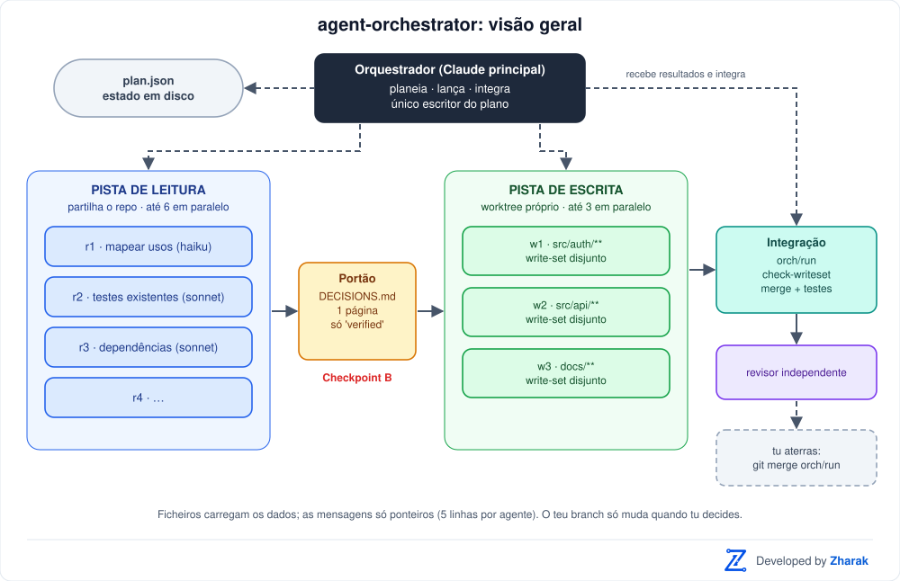
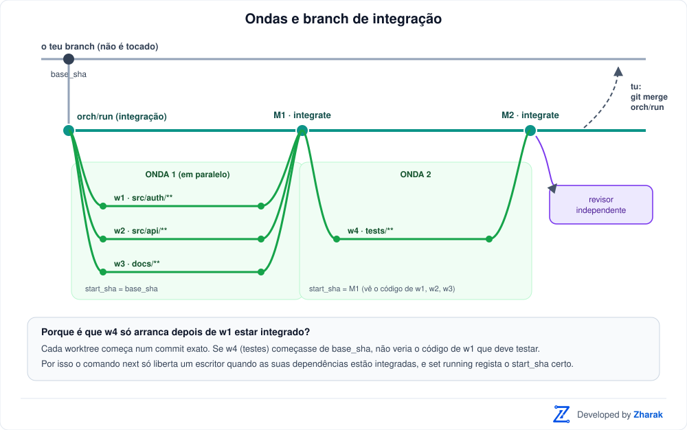
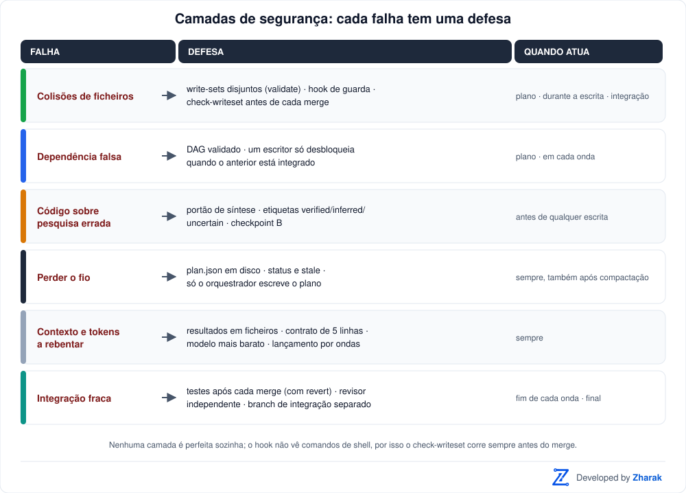

# agent-orchestrator

&nbsp; **Developed by Zharak**

Uma skill do Claude Code para coordenar **muitos subagentes em paralelo** num trabalho que mistura pesquisa e código, sem colisões, sem perder o estado e sem gastar tokens à toa.

> **Estado:** a lógica dos scripts e do hook está coberta por um autoteste (65 verificações, sem agentes).



## O problema

O Claude Code trabalha bem com subagentes quando o trabalho é linear e síncrono. Em trabalho assíncrono e paralelo, falha sempre da mesma forma:

| Falha | O que acontece |
|---|---|
| Colisões | Dois agentes editam o mesmo ficheiro ou a mesma working tree |
| Dependências falsas | O agente B arranca sem o resultado de que precisa do agente A |
| Perder o fio | O principal esquece quem está a correr, sobretudo após compactação de contexto |
| Contexto inundado | Cada subagente devolve um relatório enorme |
| Trabalho repetido | Vários agentes exploram o mesmo código do zero |
| Integração fraca | Ninguém verifica se as partes encaixam |

A skill ataca cada uma destas causas com uma regra concreta e, onde dá, com código que a faz cumprir.

## Como funciona

### Duas pistas com regras próprias

| | Pista de leitura (`read`) | Pista de escrita (`write`) |
|---|---|---|
| Isolamento | Nenhum, só lê o repo | Worktree e branch próprios |
| Concorrência por defeito | até 6 | até 3 |
| Modelo | Haiku / Sonnet | Sonnet (Opus só se difícil) |
| Saída | `findings/<id>.md` com evidência | branch + commit + `results/<id>.md` |
| Custo do erro | Baixo, descarta-se | Alto, merge e regressões |

Há ainda dois tipos de tarefa: `synth` (o **portão de síntese**, que condensa os findings em `DECISIONS.md`) e `review` (verificação independente do resultado).

### O fluxo em 7 passos



0. **Init**: regista o commit base e cria o branch de integração `orch/<run>` com o seu worktree.
1. **Plano**: decompõe o objetivo num grafo de tarefas (DAG) com dependências e *write-sets* (os ficheiros que cada escritor pode alterar). `validate` rejeita ciclos, sobreposições e escritores que não passam pelo portão.
2. **Pesquisa**: leitores em paralelo, cada um com uma pergunta concreta e um orçamento.
3. **Síntese**: um agente consolida os findings em `DECISIONS.md` (uma página). Nenhum escritor arranca antes disto.
4. **Escrita**: escritores em worktrees, por ondas, cada um dentro do seu write-set.
5. **Integração**: no fim de cada onda, `integrate` verifica os write-sets, junta os branches, corre os testes e reverte o que os quebrar.
6. **Verificação**: um revisor que nunca viu o processo compara o resultado com as decisões. A integração nunca toca no teu branch; és tu que a aterras.

**Antes de começar, a skill pergunta-te** (numa só mensagem, com opções):

1. **Modo**: manter os checkpoints ou usar o modo `auto`? Se já pediste `auto`, confirma só numa linha.
2. **Política de retentativas** para limites de uso e erros de proxy/rede: *Equilibrada* (por defeito), *Paciente*, *Falhar depressa* ou *Personalizada*.
3. **Quando as retentativas acabam**: parar e avisar-te, perguntar-te, ou saltar a tarefa e continuar com as independentes.

Por defeito há **dois checkpoints** (A: depois do plano, B: depois da síntese) onde pára para aprovação. Com `--auto` salta-os, mas continua a parar se a síntese detetar contradições.

### Vários agentes no mesmo ficheiro

Por defeito dois escritores simultâneos não podem ter o mesmo ficheiro, porque se sobrescreviam. Quando é preciso, a skill oferece quatro formas seguras (por ordem de preferência):



| Forma | Como funciona | Bom para |
|---|---|---|
| **Andaime primeiro** | Uma tarefa curta deixa uma âncora por agente (funções vazias, imports, entradas de registo) e depois todos preenchem blocos diferentes | Qualquer ficheiro "quente": é a que evita conflitos |
| **Regiões** (`--shared`) | Cada agente declara o ficheiro e uma região própria; trabalham em worktrees separados e o git junta os blocos | Código no mesmo ficheiro, em zonas diferentes |
| **Union** (`orch.py union`) | Anexos simultâneos são todos mantidos pelo git | Changelogs, requirements, listas (nunca código) |
| **Fragmentos** (`orch.py assemble`) | Cada agente escreve a sua parte num ficheiro à parte e o orquestrador monta o resultado | Documentação, relatórios, listas de testes |

Se duas regiões tocarem em linhas vizinhas, o `integrate` aborta só esse merge, avisa, e a tarefa pode ser **repetida** (*replay*) sobre o código atual, com o ramo anterior como referência.

**Não suportado:** vários agentes vivos a editar o mesmo ficheiro no mesmo checkout. Cada edição lê e reescreve o ficheiro, por isso dois agentes podem apagar o trabalho um do outro sem aviso. As quatro formas acima dão o mesmo paralelismo sem esse risco.

### Limites de uso, proxy e erros de rede

Um erro de infraestrutura não é uma falha da tarefa, por isso **não gasta** as duas tentativas que ela tem. O orquestrador classifica o erro e regista-o com `orch.py error`:

| Tipo | Exemplos | O que acontece |
|---|---|---|
| `rate_limit` | 429, "usage limit reached", "resets at…" | Pausa **toda** a corrida durante `limit_wait` (ou até à hora de reposição, se a mensagem a indicar) |
| `transient` | 502/503/504/529, proxy, `ECONNRESET`, timeout | Espera `transient_wait`, que duplica a cada erro até ao máximo |
| `task` | Resultado errado, testes a falhar | Conta como tentativa da tarefa (máximo 2) |

| Política | 1.ª espera | Após limite de uso | Retentativas por tarefa | Espera total máxima |
|---|---|---|---|---|
| Equilibrada (defeito) | 30 s, dobra até 10 min | 15 min | 5 | 3 h |
| Paciente | 60 s, dobra até 15 min | 30 min | 8 | 8 h |
| Falhar depressa | n/a | n/a | 0 | n/a |

A pausa é global porque um limite de conta ou uma falha de proxy atinge todos os agentes, não só um. Quando o orçamento se esgota, a corrida fica em **halt** e a skill diz-te o que aconteceu; depois de resolveres a causa, `orch.py resume` retoma. Se o próprio limite da tua sessão for atingido, o estado fica em disco e basta pedir ao Claude para continuar a corrida depois da reposição.

### Ondas e branch de integração



Cada worktree de escritor arranca de um commit exato (`start_sha`). Os escritores de uma onda trabalham em paralelo; no fim, o `integrate` junta-os no branch `orch/<run>`. Um escritor que depende de outro **só é desbloqueado depois de este estar integrado**, e arranca do resultado integrado. É isto que garante, por exemplo, que a tarefa de testes vê o código que deve testar.

### Camadas de segurança



## Instalação

A skill é a pasta [`skills/agent-orchestrator`](skills/agent-orchestrator). Copia-a para:

```bash
# para todos os projetos
cp -r skills/agent-orchestrator ~/.claude/skills/

# ou só para um projeto
cp -r skills/agent-orchestrator /caminho/do/projeto/.claude/skills/
```

Requisitos: `git` e `python3` (só biblioteca standard). Adiciona `.claude/runs/` ao `.gitignore` do projeto.

**Permissões.** Agentes em background não conseguem responder a pedidos de permissão: o que precisar de aprovação é recusado e o agente falha em silêncio. Antes da primeira corrida, permite no `.claude/settings.json` o que eles usam (`Edit`, `Write`, `Bash(git:*)`, `Bash(python3:*)` e o comando de testes).

**Hook opcional (recomendado com 3+ escritores).** Bloqueia um escritor que tente editar fora do seu write-set ou no teu checkout principal. Instruções em [`hooks.md`](skills/agent-orchestrator/references/hooks.md).

## Utilização

A skill ativa-se sozinha com pedidos como:

> *"Usa o máximo de agentes que puderes para migrar a autenticação para JWT: primeiro mapeia os usos atuais, depois implementa e atualiza os testes e a documentação."*

O que se segue, resumidamente: o Claude propõe o plano (checkpoint A), lança os leitores, apresenta o `DECISIONS.md` (checkpoint B), lança os escritores por ondas, integra, verifica, e mostra-te como aterrar o resultado.

### Comandos do `orch.py`

O Claude usa-os por ti; ficam documentados para depurar ou retomar uma corrida.

| Comando | Para quê |
|---|---|
| `init <dir> --goal T [--test-cmd C]` | Cria a corrida, o branch e o worktree de integração |
| `add / update / remove` | Edita o plano e revalida (recusa planos inválidos) |
| `validate <dir>` | Ciclos, dependências, write-sets, portão de síntese |
| `next <dir>` | Tarefas que podem arrancar agora, respeitando limites e dependências |
| `set <dir> <id> <estado>` | Regista o estado; em escritores grava o `start_sha` |
| `status <dir>` | Tabela de estado; é o primeiro comando depois de uma compactação |
| `stale <dir>` | Tarefas "a correr" que parecem mortas |
| `error <dir> <id> --kind K` | Regista um erro de limite/proxy/rede e aplica a política de espera |
| `policy <dir>` | Mostra ou altera o modo e a política de retentativas |
| `resume <dir>` | Retoma uma corrida parada depois de resolveres a causa |
| `union <dir> <ficheiros>` | Marca ficheiros só de anexos para fusão por *union* |
| `assemble <dir> --target F --parts a,b` | Monta um ficheiro a partir de fragmentos |
| `bootstrap <dir> <id>` | Passo 0 do escritor: posiciona o worktree e arma o hook |
| `check-writeset <dir> <id>` | O escritor ficou dentro do seu write-set? |
| `integrate <dir>` | Verifica, junta, testa e reverte se falhar |
| `land <dir>` | Resumo final e como aterrar o resultado |
| `cleanup <dir> [--all]` | Remove branches e worktrees já integrados |

### Poupança de tokens

Os ficheiros carregam os dados e as mensagens carregam só ponteiros: cada agente devolve no máximo 5 linhas e escreve o resto num ficheiro. O `DECISIONS.md` funciona como compressão (dez findings viram uma página) e os escritores leem só isso. O modelo é o mais barato que serve: Haiku explora, Sonnet analisa e implementa, Opus planeia e sintetiza. Lança-se por ondas, nunca "tudo de uma vez", e abaixo de três unidades independentes de trabalho a skill recomenda não paralelizar.

## Estrutura

```
.
├── README.md
├── LICENSE                           # Apache-2.0
├── NOTICE                            # autoria Zharak
├── CONTRIBUTING.md                   # como contribuir
├── docs/img/                         # diagramas e logótipo deste README
└── skills/agent-orchestrator/
    ├── SKILL.md                      # instruções para o Claude (em inglês)
    ├── scripts/
    │   ├── orch.py                   # estado, ondas, integração
    │   ├── selftest.py               # autoteste sem agentes
    │   └── hooks/writeset_guard.py   # hook PreToolUse
    └── references/
        ├── plan-schema.md            # esquema do plano + exemplo
        ├── brief-templates.md        # briefs: leitor, síntese, escritor, revisor
        ├── hooks.md                  # como registar o hook
        └── verify-assumptions.md     # experiências de validação
```

O `SKILL.md` e as referências estão em inglês porque é a língua em que o Claude Code segue melhor as instruções; o Claude continua a responder-te na tua língua.

## Testes

```bash
python3 skills/agent-orchestrator/scripts/selftest.py
```

Cria um repositório temporário, simula escritores com worktrees reais e verifica: bootstrap, write-sets, integração por ondas, conflitos, reversão por testes falhados, edição do plano, o hook, e a política de retentativas (espera, pausa global, esgotamento e retoma) e os ficheiros partilhados (regiões, conflito, union e fragmentos).

## Contribuir

A comunidade é bem-vinda: validação em sessões reais, melhorias aos scripts, diagramas e documentação. Ver [CONTRIBUTING.md](CONTRIBUTING.md).

## Licença

Este projeto é distribuído sob a licença **[Apache-2.0](LICENSE)**. Copyright 2026 Zharak.

Podes usar, modificar e distribuir o código, incluindo em contexto comercial, desde que:
- mantenhas o ficheiro [`LICENSE`](LICENSE) e o aviso de copyright;
- preserves o ficheiro [`NOTICE`](NOTICE) (com "Developed by Zharak") nas cópias e nos trabalhos derivados;
- indiques as alterações que fizeres aos ficheiros.

A licença inclui uma concessão de patentes e o software é fornecido "tal como está", sem garantias.

**Marca.** O nome e o logótipo Zharak **não** estão licenciados: não podem ser usados para sugerir que um trabalho derivado foi feito ou aprovado pela Zharak.

---

<div align="center">
  
  <br>
  <sub><b>Developed by Zharak</b></sub>
</div>
